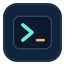

# Local Coding Desk

Local Coding Desk runs coding agents on your Mac. The Apple Silicon build accepts authenticated connections from this machine and disables product analytics, OTLP export, cloud access, feedback, and automatic updates. Codex, Claude Code, and other configured tools retain their own network behavior.

[Download for Apple Silicon Mac](https://github.com/weivwang/local-coding-desk/releases/latest) · [Build and privacy details](LOCAL-EDITION.md)

## Attribution

Local Coding Desk is an unofficial fork of [T3 Code](https://github.com/pingdotgg/t3code/tree/5e3bc17587a48b1d1de02e91d566acde3ca41863) and is unaffiliated with T3 Tools, Inc. The original copyright and MIT terms are preserved in [LICENSE](LICENSE). The upstream trademark notice is preserved in [TRADEMARK.md](TRADEMARK.md).
